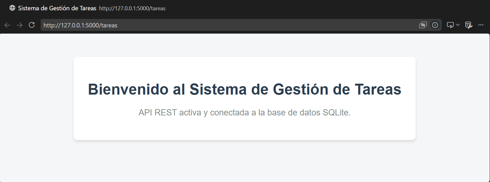

# PFO 2: Sistema de Gestión de Tareas con API y Base de Datos

API REST desarrollada en **Python** utilizando: 
* microframework **Flask**
* persistencia relacional en **SQLite**
Se implemento autenticación con hashing de contraseñas y un cliente de consola interactivo.

---

## 🚀 Requisitos Previos

* Python 3.10 o superior
* Gestor de paquetes `pip`

---

## 📦 Instalación de Dependencias

Ejecutar en tu terminal el siguiente comando para instalar las librerías necesarias:

```bash
python -m pip install flask requests
```

---

## 🛠️ Estructura del Proyecto

```text
PFO 2/
├── database.py     # Inicialización y esquemas de SQLite (usuarios y tareas)
├── servidor.py     # API REST en Flask con endpoints (/registro, /login, /tareas)
├── cliente.py      # Interfaz de consola interactiva con peticiones HTTP
├── test_api.py     # Suite de 7 pruebas automatizadas de integración y seguridad
├── tareas.db       # Archivo de base de datos relacional SQLite
├── README.md       # Documentación e instrucciones
└── index.html      # Página web de presentación para GitHub Pages
```

---

## ⚙️ Instrucciones de Ejecución

### 1. Iniciar el Servidor API
En una primera terminal, ejecuta:

```bash
python servidor.py
```
El servidor quedará activo escuchando en `http://127.0.0.1:5000`.

### 2. Ejecutar el Cliente de Consola
En una segunda terminal paralela, ejecuta:

```bash
python cliente.py
```
Aparecerá: 
* Menú interactivo para registrar usuarios, 
* Iniciar sesión 
* Consultar el endpoint de bienvenida de `http://127.0.0.1:5000/tareas`.



### 3. Ejecutar las Pruebas Automatizadas
Para validar los códigos de estado HTTP (200, 201, 400, 401, 409) y el comportamiento defensivo:

```bash
python test_api.py
```

---
github pages: https://luma2001.github.io/programacionsobreredes-pfo2/

---

## 🧠 Respuestas Conceptuales

### 1. ¿Por qué hashear contraseñas?
Las contraseñas nunca deben guardarse en texto plano. Un hash criptográfico es una función matemática unidireccional e irreversible. Al usar `werkzeug.security` con técnicas de salting aleatorio, incluso si la base de datos es vulnerada o filtrada, los atacantes no pueden recuperar las contraseñas originales ni utilizar ataques mediante tablas arcoíris o fuerza bruta masiva.

### 2. Ventajas de usar SQLite en este proyecto
* **Serverless (Sin servidor):** Funciona como una biblioteca embebida que almacena los datos directamente en un archivo local (`tareas.db`), sin requerir configuración de servicios externos de bases de datos.
* **Integración nativa:** Python incluye el módulo `sqlite3` de forma predeterminada.
* **Portabilidad:** Permite ejecutar, probar y compartir el proyecto en cualquier entorno de desarrollo sin configuraciones adicionales de red.